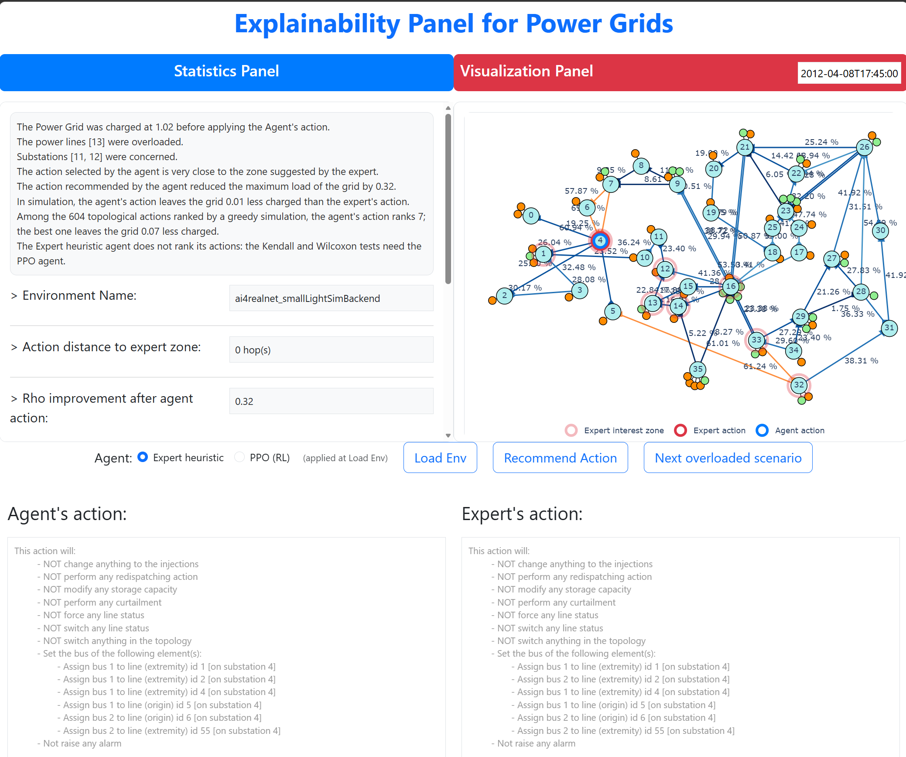

# T2.3_explainability_dashboard
This repository provides an explainability panel for RL agents developed for Power Grid use case. It is related to Task 2.3 of AI4REALNET project.


# Installation guide
To be able to run the experiments in this repository, the following steps show how to install this package and its dependencies from source.

### Setup a Virtualenv (optional)
#### Create an environment using `Conda` (recommended)
```bash
conda create -n env_explainability python=3.10
conda activate env_explainability
```

#### Create a virtual environment using `virtualenv`
```bash
cd my-project-folder
pip3 install -U virtualenv
python3 -m virtualenv my_env
source my_env/bin/activate
```

### Install the prerequisites
> [!IMPORTANT] 
> These steps are mandatory to be able to use the package and its different functionalities
#### ExpertOp4Grid package
```bash
git clone git@github.com:Mleyliabadi/ExpertOp4Grid.git
cd ExpertOp4Grid
pip install -U .
```

#### LJN Agent package
```
git clone git@github.com:Mleyliabadi/l2rpn-2023-ljn-agent.git
cd l2rpn-2023-ljn-agent
pip install -U .
```

#### ExpertAgent package
```
git clone git@github.com:AI4REALNET/T2.1_deep_expert.git
cd T2.1_deep_expert
pip install -U .
```

### Install the requirements for the current package
```bash
pip install -r requirements.txt
```

## Requirements
Two major requirements for this explainability panel are:
1. **Agent**: one of the two agents of the [ExpertAgent](https://github.com/AI4REALNET/T2.1_deep_expert) package developed in the context of AI4REALNET project, selected in the dashboard before pressing `Load Env`:
    - **Expert heuristic** (`ExpertAgentHeuristic`);
    - **PPO (RL)** (`ExpertAgentRL`), a trained PPO policy. By default, the released model of the ExpertAgent package is used. To use another model, set the `PPO_MODEL_PATH` environment variable to its path, without the `.zip` extension:
      ```bash
      export PPO_MODEL_PATH=/path/to/local_data/ai4realnet_small/PPO_SB3/models-v1/model/PPO_SB3
      ```
> [!WARNING]
> This package works only with these agents. It could be improved in future to be adapted to other agents.

2. **Environment**: One of the power grid environments designed for the projet. It could also be used for other environments.
> [!WARNING]
> This package works only with [`ai4realnet_small`](https://github.com/AI4REALNET/grid2op-scenario) environment designed for AI4REALNET project and that corresponds to the first usecase of Power Grids. It could be improved in future to include other environments.

3. **ExpertOp4Grid**: You should configure the ExpertOp4Grid configuration file, which is available for an example in [`explainability_panel/config_expert.ini`](explainability_panel/config_expert.ini)

## Dashboard
A screenshot of the Explainability dashboard is provided below. It composed of two main parts:
1. **Statistics Panel**: some statistics allowing to analyze in more detail the agent's action and its impacts. These statistics are:
    - **Distance to the expert zone**: the number of hops, on the grid as it was when the agent decided, between the closest substation touched by the agent's action and the expert interest zone (the substations identified by [ExpertOp4Grid](https://github.com/Mleyliabadi/ExpertOp4Grid), and those of its best action). The topological part of the agent's action is used when there is one, else the substations whose injections it changes;
    - **$\rho$ improvement**: how much the agent's action reduces the maximum load of the grid ($\rho$), measured on the real step;
    - **$\rho$ difference**: the maximum $\rho$ after the agent's action minus the one after the best expert action, both simulated from the same state. A positive value means that the agent did worse than the expert;
    - **Rank among the greedy actions**: the greedy strategy ranks the 604 topological actions of the PPO agent's action space (and "do nothing") by the maximum $\rho$ obtained when simulating them. The rank of the agent's action among them, and its regret: its maximum $\rho$ minus the best one (negative when the agent does better, for example by combining topology with redispatching);
    - **Kendall $\tau$** (PPO agent only): rank correlation between the agent's preference order of its $k=20$ preferred actions (highest logits of its policy) and their simulated maximum $\rho$. $\tau$ close to 1: the agent prefers the actions the simulation finds better; close to 0: its order is unrelated to their outcome; negative: it prefers worse actions;
    - **Wilcoxon signed-rank test** (PPO agent only): one-sided test between the simulated maximum $\rho$ of the agent's $i$-th preferred action and of the $i$-th best greedy action, $i=1..k$. If the $p$-value is less than $0.05$, the agent's preferred actions are significantly worse (95% confidence) than the best greedy actions. Hence, the agent's ranking may not be reliable.

    The $k$ values of a test all come from a single decision: they are not independent samples, so the $p$-values describe this decision rather than prove a general property of the agent. Note also that the greedy top-$k$ is, by construction, the best possible set of $k$ actions: the Wilcoxon test is significant unless the agent ranks almost like the greedy strategy.

2. **Visualization panel**: the overload graph obtained using the ExpertOp4Grid package when the grid is loaded with an overload, else the grid. After `Next overloaded scenario`, the ends of the overloaded lines are circled. After `Recommend Action`, the grid after the agent's action shows the expert interest zone, the substations of the expert's action and those of the agent's action.



### Usage
You can run the dashboard by simply executing the following command:
```bash
cd explainability_panel
python explainability.py
```

Choose the agent (Expert heuristic or PPO) before pressing `Load Env`. There are three buttons:
1. `Load Env`: Load (reset) the environment and load the chosen agent.
2. `Next overloaded scenario`: fast-forward the scenario with "do nothing" actions to the next time step with an overloaded line (or to the end of the episode).
3. `Recommend Action`: get the actions of the agent and of the expert on the current state, compute the statistics, and apply the agent's action.

When the episode ends (game over or end of the scenario), press `Load Env` to start again.

Two additional zones:
- **Explanation**: A text interpreting the statistics shown in the left side of the panel. 
- **Action description**: prints the action recommended by the Agent.

## License information
This Source Code is subject to the terms of the Mozilla Public License (MPL) v2 also available [here](LICENSE)